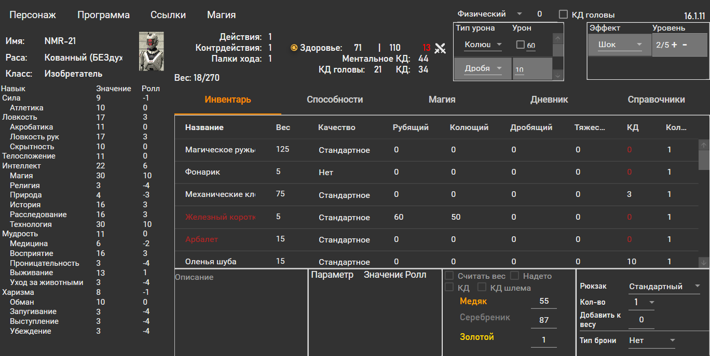
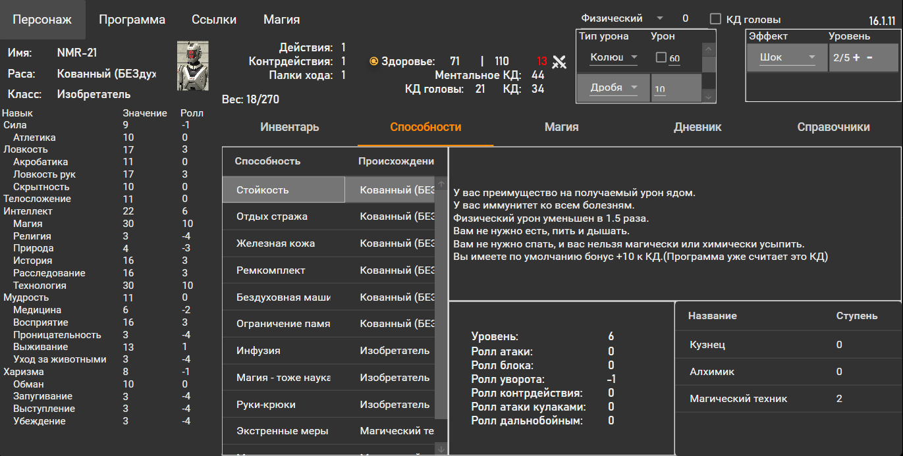
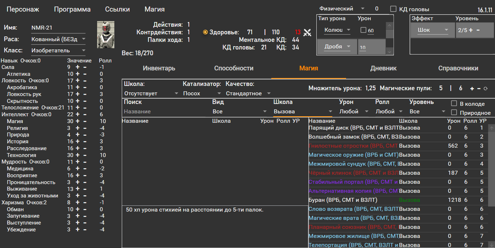
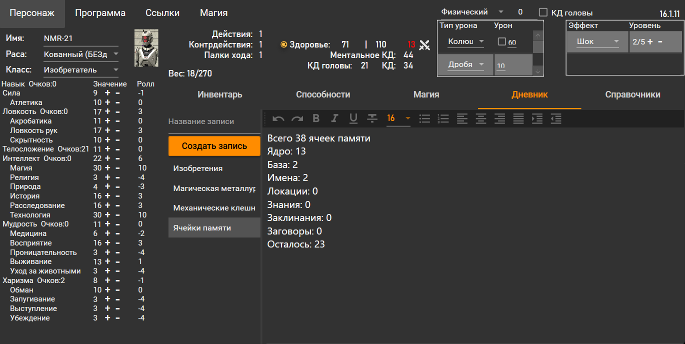
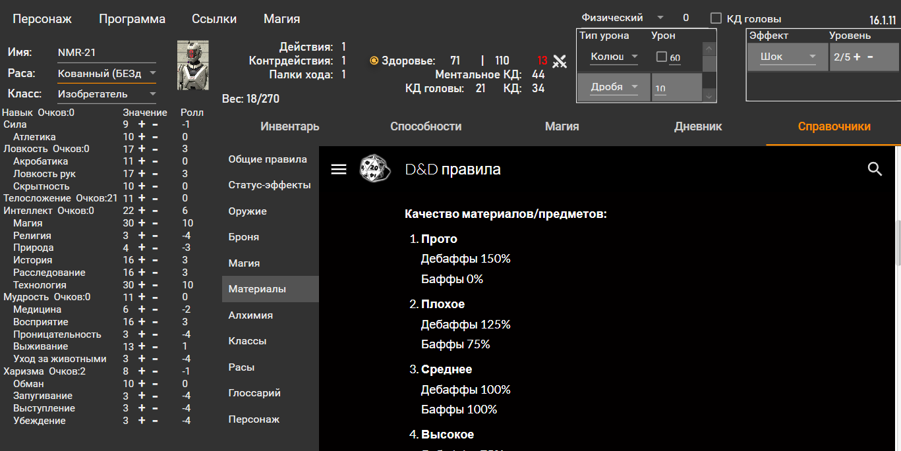

# ⚔️ D&D Helper

  <em>A companion for adventures in a custom tabletop RPG system.</em>

> [!IMPORTANT]
> **Language:** The entire application is available in **Russian only**. There are no plans to add support for other languages.

> [!WARNING]
> **This application is designed exclusively for a custom D&D-inspired ruleset. It is NOT compatible with the official Dungeons & Dragons rules.**

---

## 🧙 About the Project

**D&D Helper** is a desktop application created to make tabletop RPG sessions easier, more organized, and more enjoyable.

Designed for a small group of players, it brings the most important aspects of character management into one place. Forget about constantly switching between documents, spreadsheets, and handwritten notes — keep everything you need right at your fingertips.

From equipment and abilities to spells and personal notes, your character's entire journey lives in one application.

---

## ✨ Features

### 🎒 Inventory & Equipment

Keep track of your character's belongings, weapons, armor, and other equipment. Manage your inventory and keep everything organized in one place.

### ⚡ Character Abilities

View and manage your character's abilities. Keep important character information easily accessible during your adventures.

### 🔮 Magic & Spells

A dedicated section for your character's magical abilities. Keep your magic-related information organized and ready for your next encounter.

### 📖 Personal Diary

Every adventure has a story worth remembering.

Use the built-in diary to write down important events, clues, discoveries, character thoughts, or anything else you don't want to forget.

### 🌐 Reference Books

Need to check a rule or look something up during a session?

The application includes a built-in browser displaying an online website with game rules. Access reference materials without leaving the application.

---

## 🖥️ System Requirements

| Requirement      | Specification                   |
| :--------------- | :------------------------------ |
| Operating System | Windows 10 or newer             |
| Runtime          | .NET 9.0                        |
| Architecture     | Windows-compatible architecture |

> [!IMPORTANT]
> **.NET 9.0 Runtime is required to launch the application.**

You can download it from the official Microsoft website:

**[⬇️ Download .NET 9.0 Runtime](https://dotnet.microsoft.com/en-us/download/dotnet/9.0)**

Make sure to install the appropriate Windows runtime for your system.

---

## 🚀 Getting Started

1. Make sure you are running **Windows 10 or newer**.
2. Install the **.NET 9.0 Runtime** using the link above.
3. Download the latest available version of D&D Helper.
4. Extract the application files, if necessary.
5. Launch the application and prepare for your adventure!

---

## ⚔️ A Final Note

D&D Helper was created for a specific group and a custom tabletop RPG system. It is a personal project intended to simplify character management and reduce the amount of manual bookkeeping during gameplay.

It is not an official Dungeons & Dragons product and is not affiliated with Wizards of the Coast.
